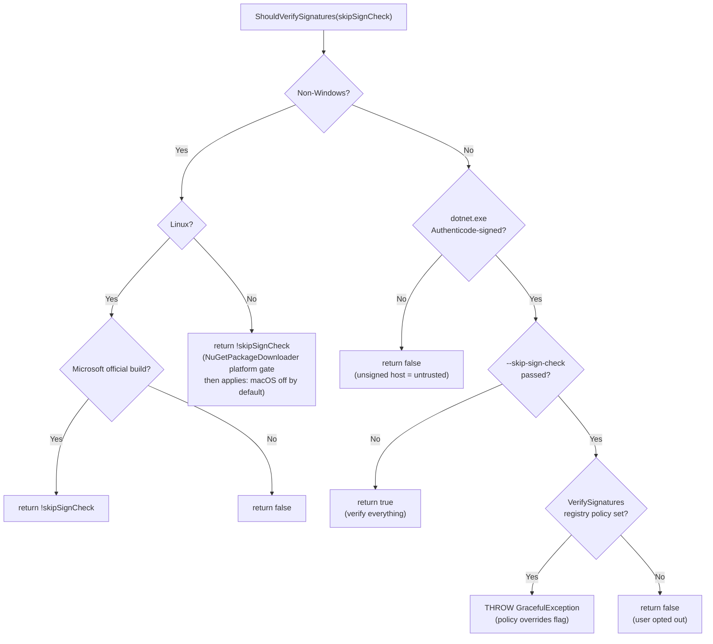

# Workload Signing Verification

## Overview

Workload commands use **two independent signature verification systems**:

| Layer | What is verified | Technology | Platform |
|-------|-----------------|------------|----------|
| **NuGet package signing** | `.nupkg` files from NuGet feeds | `NuGetPackageDownloader` + `FirstPartyNuGetPackageSigningVerifier` | Windows and Linux (Microsoft official builds; macOS opt-in) |
| **MSI Authenticode signing** | `.msi` files extracted from NuGet packages | `WinVerifyTrust` + Microsoft root cert chain | Windows only |

For details on how `NuGetPackageDownloader` performs signature verification (platform gate,
verification modes, TRP certificate bundles), see
[NUGET-SIGNATURE-VERIFICATION.md](../../NugetPackageDownloader/NUGET-SIGNATURE-VERIFICATION.md).

### Why verification is gated on the host being signed (Windows)

On Windows, signature verification is skipped when the dotnet host (`dotnet.exe`) is unsigned. Unsigned
hosts indicate a locally-built SDK, preview build, or source-build — environments where
workload packages are also likely to be unsigned. Enforcing downstream signature checks when
the host itself is unsigned would break these development workflows without providing meaningful
security benefit.

When the host *is* signed (i.e., an official Microsoft release), verification is enabled
by default. The `--skip-sign-check` flag allows users to opt out when needed (e.g., private
feeds), unless the `VerifySignatures` registry policy is set by an administrator.

### Why workloads use first-party verification

Workloads are selected from a fixed list provided by the .NET SDK. If the SDK itself is signed
by Microsoft, there is an implicit chain of trust: the user chose a workload from Microsoft's
list, so the workload packages should also come from Microsoft. This justifies the first-party
certificate check (`Verify()`) that regular NuGet restore does not perform.

## Platform Support

### Windows
Both NuGet and MSI verification are fully supported. `ShouldVerifySignatures()` checks whether
the dotnet host is Authenticode-signed (via CsWin32 APIs) and respects `--skip-sign-check`
and the `VerifySignatures` registry policy.

### Linux and macOS
Workload packs are file-based (no MSI), so only NuGet package verification applies.
There is no host-signed check (`SignCheck.IsDotNetSigned()` uses Windows Authenticode APIs)
or administrator policy on these platforms.

- **Linux**: Microsoft official builds request verification by default, unless
  `--skip-sign-check` is specified. Other builds do not request workload package verification.
  Official builds use the SDK's Trusted Root Program certificate bundles; set
  `DOTNET_NUGET_SIGNATURE_VERIFICATION=false` to opt out.
- **macOS**: not verified by default, because macOS's certificate distrust model overrides
  NuGet's custom trust roots ([NuGet/Home#11986](https://github.com/NuGet/Home/issues/11986)).
  Set `DOTNET_NUGET_SIGNATURE_VERIFICATION=true` to opt in.

The certificate bundles are point-in-time snapshots, so a package whose certificate chains to
a newly added root can fail verification until the SDK ships an updated bundle. See
[NUGET-SIGNATURE-VERIFICATION.md](../../NugetPackageDownloader/NUGET-SIGNATURE-VERIFICATION.md#platform-gate).

## Decision Flow

### `WorkloadUtilities.ShouldVerifySignatures()`

Two overloads:
- `ShouldVerifySignatures(bool skipSignCheck)` — for user-facing commands with `--skip-sign-check`
- `ShouldVerifySignatures()` — parameterless, for non-interactive code paths; equivalent to
  `ShouldVerifySignatures(false)`

The result sets `VerifySignatures` in `WorkloadCommandBase`, which is passed to **both** the
NuGet downloader (as `verifySignatures`) and the installer factory (as `verifyMsiSignature`):

### Registry Policies (Windows only)

`HKLM\SOFTWARE\Policies\Microsoft\dotnet\Workloads`:

| Value Name | Effect |
|-----------|--------|
| `VerifySignatures` (DWORD ≠ 0) | Prevents `--skip-sign-check` from disabling verification |
| `AllowOnlineRevocationChecks` (DWORD = 0) | Restricts CRL checks to local cache only |

## NuGet Verification (Layer 1)

Workload commands create the NuGet downloader via `CreateForWorkloads(VerifyNuGetSignatures)`.
When `VerifyNuGetSignatures` is `true` and the platform gate allows it, `VerifySigning()` runs
after each download in **strict** mode — requiring both a valid NuGet signature and a Microsoft
author certificate. See
[NUGET-SIGNATURE-VERIFICATION.md](../../NugetPackageDownloader/NUGET-SIGNATURE-VERIFICATION.md)
for the full verification pipeline.

## MSI Authenticode Verification (Layer 2, Windows only)

### When it runs
When retrieving MSI payloads from the cache in `MsiPackageCache.TryGetPayloadFromCache()`,
before any MSI installation or repair.

### What it checks (two sequential steps)
1. **`Signature.IsAuthenticodeSigned()`** — `WinVerifyTrust` with full chain and revocation check.
2. **`Signature.HasMicrosoftTrustedRoot()`** — certificate chain terminates in a Microsoft root
   (`CERT_CHAIN_POLICY_MICROSOFT_ROOT`).

### `ValidateMsiDatabase()` is NOT a signature check
`NetSdkMsiInstallerClient.ValidateMsiDatabase()` calls `WindowsInstaller.VerifyPackage()` to
validate the MSI database structure (tables, columns, schema). This is a structural integrity
check, **not** a cryptographic signature check.

## Entry Points

### 1. `WorkloadCommandBase` (install/update/repair/etc.)
- `ShouldVerifySignatures(skipSignCheck)` → `VerifySignatures`
- `CreateForWorkloads(VerifySignatures)` for the NuGet downloader
- Subclasses pass `VerifySignatures` to `WorkloadInstallerFactory.GetWorkloadInstaller(verifyMsiSignature:)`

### 2. `WorkloadInfoHelper` (list/info display)
- Delegates to `ShouldVerifySignatures()` for MSI verification default
- Does not typically perform installations

### 3. `WorkloadIntegrityChecker.RunFirstUseCheck()`
- `ShouldVerifySignatures()` → `verifySignatures` (single value for both layers)
- Reinstalls existing workloads to verify integrity

### 4. `WorkloadManifestUpdater.GetAdvertisingUpdaterInstance()` (background advertising)
- NuGet: `ShouldVerifySignatures()` (respects policy, no user flags)
- MSI: **disabled** (`false`) — only downloads advertising manifests, not MSIs. This path builds a
  lightweight `WindowsMsiManifestInstaller`/`FileBasedManifestInstaller` directly (via
  `WorkloadAdvertisingManifestUpdater`) instead of `WorkloadInstallerFactory`, so it never constructs
  the full `NetSdkMsiInstallerClient`/`FileBasedInstaller` or elevated MSI IPC.

### 5. `NetSdkMsiInstallerClient.Create()` (fallback downloader)
- `CreateForWorkloads(verifyNuGetSignatures: false)` — MSI Authenticode is the primary gate

## `IsDotNetSigned()` vs. `ShouldVerifySignatures()`

- `IsDotNetSigned()` — low-level factual check: "is the host binary Authenticode-signed?"
- `ShouldVerifySignatures()` — policy decision incorporating host signing status,
  `--skip-sign-check`, and `VerifySignatures` registry policy

**All workload entry points should use `ShouldVerifySignatures()`.** `IsDotNetSigned()` is an
internal building block and should not be called directly.
